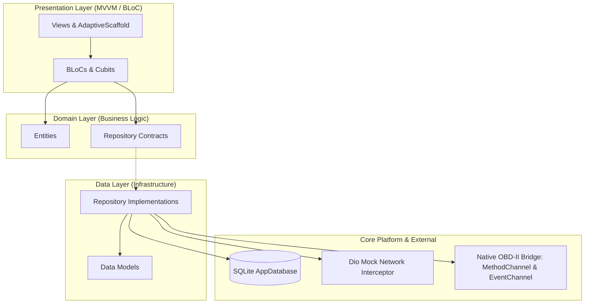
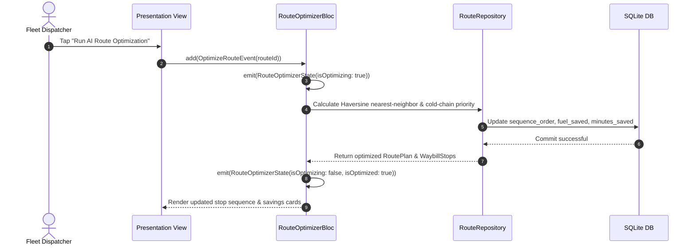
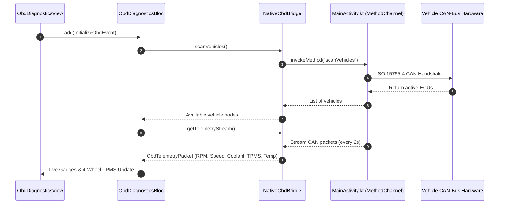

# FleetRoute

[](https://github.com/Safeer-Hussain/fleetroute_app/actions/workflows/ci.yml)
[](https://flutter.dev)
[](https://dart.dev)
[](https://developer.android.com)
[](LICENSE)

**FleetRoute** is an Enterprise Autonomous Fleet Telematics, Multi-Stop Route Optimization, Native OBD-II Vehicle Diagnostics, Electronic Proof of Delivery (ePOD), and On-Device AI Dispatch Copilot Platform built in Flutter. Engineered specifically for high-capacity freight corridors (e.g., Lahore Industrial Zones, Multan Road Trunk, M2 Highway, and Ring Road interchanges), FleetRoute achieves enterprise-tier dispatch capability with zero external recurring API costs.

---

## Architecture & System Overview

FleetRoute implements a strict Feature-First Clean Architecture paired with BLoC/Cubit state management, SQLite offline caching, and native bidirectional hardware channels.

### Clean Architecture Layers



### BLoC State Flow



### Native OBD-II CAN-Bus Telemetry Bridge



---

## Core Production Modules

| Module | Capability | Implementation Highlights |
| :--- | :--- | :--- |
| **Module 1: GPS Command Map & Geofence** | Real-time fleet tracking across 12 vehicles | `flutter_map` OpenStreetMap integration, 4.5km primary logistics geofence, smooth kinematic coordinate animation, categorized vector markers. |
| **Module 2: Route Optimizer & Scheduler** | Multi-stop shortest path sequencer | Haversine distance solver prioritizing urgent cold-chain consignments, fuel and time savings math, drag-and-drop stop reordering, validated route creation. |
| **Module 3: Electronic Proof of Delivery** | Paperless chain-of-custody ledger | Custom touch digital signature canvas (`CustomPainter`), SVG vector path capture, consignee condition checklist, formatted receipt copying, and JSON export. |
| **Module 4: Native OBD-II Diagnostics** | Direct vehicle ECU telematics | `MethodChannel` control and `EventChannel` telemetry streaming, 6 live gauges (RPM, Speed, Coolant, Fuel, Cold-Chain, Battery), 4-wheel TPMS chassis monitor, active DTC trouble code scanner and clearing. |
| **Module 5: On-Device AI Dispatch Copilot** | Autonomous operations assistant | Real-time SQLite fleet delay and DTC correlation, token-by-token streaming with defensive cleanup, prompt shortcuts, and edge-to-edge `fl_chart` analytics. |

---

## Quality & Resilience Safeguards

- **Zero Hardcoded Colors**: Strict theme parity between Obsidian Logistics Dark (`#0B132B`) and Crisp Daylight Mode via Material 3 `ColorScheme`.
- **Landscape Viewport Safety (360dp Height)**: Compact left `NavigationRail` (56dp minWidth) wrapped in `SingleChildScrollView` + `IntrinsicHeight`, compressed 36dp `AppBar`, dual-pane master-detail layouts.
- **Unique Hero Tags**: Every `FloatingActionButton` defines an explicit, unique hero tag (`fab_fleet_map_recenter`, `fab_dispatch_new_route`, `fab_epod_capture`, `fab_obd_scan_dtc`, `fab_ai_dispatch_clear`).
- **Keyboard Safety**: Root dismiss gesture detector, zero double-applied `viewInsets.bottom`.
- **Android SDK 36 Compatibility**: `compileSdk = 36`, `targetSdk = 36`, `minSdk = 21`, with Impeller Vulkan crash defenses configured.
- **Offline Field Mode**: Banner alert when disconnected, buffering GPS waypoints and ePOD signatures directly to local SQLite.
- **Recruiter Debug Drawer**: Long-press app version in Settings to toggle simulated network latency (0-2000ms), force HTTP 503 gateway retry views, and inject simulated geofence breaches or DTC engine warnings.

---

## Verification & Sprint Gate

To run the full suite of automated checks, formatting, static analysis, and unit/widget tests:

```bash
dart run tool/sprint_gate.dart
```

This enforces:
1. `flutter pub get`
2. `dart format --output=none --set-exit-if-changed lib test tool`
3. `flutter analyze --no-fatal-infos --no-pub`
4. `flutter test --no-pub` (18 automated tests passing)
5. Connected physical device `adb logcat` exception scan

---

## Clean-Room NDA Disclaimer

This software repository is a clean-room, original implementation developed independently for portfolio demonstration and autonomous fleet dispatch research. No proprietary code, non-public intellectual property, or confidential client trade secrets are contained within this repository.
