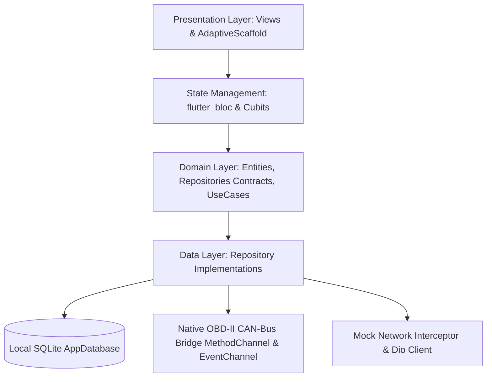

# FleetRoute Enterprise - Product Requirements Document (PRD)

## 1. Executive Summary & Vision
FleetRoute is a next-generation Enterprise Autonomous Fleet Telematics, Multi-Stop Route Optimization, Native OBD-II Vehicle Diagnostics, Electronic Proof of Delivery (ePOD), and On-Device AI Dispatch Copilot Platform built in Flutter.

Designed for heavy-duty freight carriers, pharmaceutical cold-chain distributors, and urban express couriers operating across high-density logistics corridors (e.g., Lahore Metropolitan Network, Multan Road, M2 Motorway, and Ring Road Interchanges), FleetRoute operates with zero external recurring API costs via local-first SQLite persistence, on-device spatial solvers, and direct CAN-bus hardware bridges.

---

## 2. Core Personas
1. **Fleet Dispatch Operations Director**: Monitors corridor throughput, geofence compliance, asset distribution, and end-of-shift SLA delivery rates.
2. **Cold-Chain Logistics Supervisor**: Tracks perishable cargo temperature excursions (-18°C to -22°C deep freeze) and receives automatic rerouting when traffic bottlenecks threaten biological payloads.
3. **Heavy Freight Driver / Owner-Operator**: Receives optimized route sequences, captures tamper-evident digital signatures on consignee delivery, and conducts real-time OBD-II vehicle health diagnostics.
4. **Maintenance Workshop Chief**: Analyzes active Diagnostic Trouble Codes (DTCs), monitors 4-wheel tire pressures (TPMS), and schedules preventive depot maintenance.

---

## 3. High-Level Architecture
FleetRoute adheres to strict Feature-First Clean Architecture + MVVM/BLoC pattern:

---

## 4. Feature Specifications

### Module 1: Live Fleet GPS Command Map & Geofence Radar
- **Canvas**: Interactive OpenStreetMap rendered via `flutter_map` (zero billing keys required).
- **Fleet Scale**: 12 active vehicles tracked with real-time vector status pins:
  - In Transit (Emerald)
  - Cold-Chain Transit (Cyan/Sky)
  - Delayed (Red)
  - Idle at Depot (Slate)
- **Geofence Enforcement**: 4.5km primary logistics perimeter around Lahore Freight Hub. Spatial distance calculated via Haversine. Automatic warning notification on perimeter breach.
- **Simulation**: Built-in kinematic motion generator smoothly animating coordinates, updating velocity, heading, and route progress.

### Module 2: Multi-Stop Route Optimizer & Dispatch Scheduler
- **Optimization Engine**: On-device greedy nearest-neighbor algorithm using spherical Haversine formulas. Prioritizes `URGENT_COLD_CHAIN` waybills before general scheduled freight.
- **KPI Metrics**: Calculates and displays exact Distance Saved (km), Fuel / Energy Saved (Liters and %), and Travel Time Recovered (Minutes).
- **Manual Control**: Reorderable stop list allowing drag-and-drop manual sequencing.
- **Creation Flow**: Validated modal form for creating custom routes with assigned vehicles, destination hubs, and cargo tonnage.

### Module 3: Electronic Proof of Delivery (ePOD) & Waybill Manifest
- **Manifest Ledger**: Searchable and filterable by status (`ALL`, `OUT_FOR_DELIVERY`, `DELIVERED`, `EXCEPTION`).
- **Touch Digital Signature Pad**: High-fidelity `CustomPainter` recording stylus/finger strokes, calculating SVG vector representations, and validating signature presence before allowing delivery confirmation.
- **Chain of Custody**: Stores consignee name, cargo inspection status, timestamp, and coordinates in SQLite ledger.
- **Receipt Export**: One-tap formatted receipt copy to system clipboard and raw JSON manifest export.

### Module 4: Native OBD-II CAN-Bus Diagnostics & TPMS Monitor
- **Native Platform Channels**:
  - `MethodChannel('com.safeer.fleetroute/obd_control')`: Device scanning, ECU handshakes, DTC scans, and code clearing.
  - `EventChannel('com.safeer.fleetroute/obd_telemetry')`: 2-second streaming CAN-bus packets (RPM, Speed, Coolant, Fuel, Battery, Cold-Chain Temp, TPMS).
- **TPMS Chassis Diagram**: Visual 4-wheel tire pressure monitor highlighting under-inflation (<32 PSI) or over-inflation (>38 PSI).
- **Diagnostic Trouble Code Scanner**: Displays standardized SAE fault codes (e.g. `P0128 Coolant Thermostat`, `C0034 Wheel Speed Sensor`) with severity indicators and 1-tap clear / schedule service workflows.

### Module 5: On-Device AI Dispatch Copilot & Analytics
- **Intelligence Model**: Context-aware operations assistant querying live SQLite fleet records, active delay corridors, cold-chain excursion logs, and DTC trouble codes.
- **Token Streaming**: Smooth token-by-token emission with transient progress indicator strictly guarded inside `try ... finally` blocks to eliminate hanging loading states.
- **Prompt Presets**:
  - Optimize Delayed Routes & Reroute Traffic
  - Audit Vehicles With Active OBD-II Faults
  - Analyze Weekly Fuel & Cold-Chain Efficiency
  - Generate End-of-Shift Fleet Executive Summary
- **Analytics Charting**: Edge-to-edge `fl_chart` spline graphs tracking On-Time Delivery % and Fuel Consumption curves.

---

## 5. Non-Functional Requirements & Resilience
1. **Zero Hardcoded Colors**: Strict theme parity between Obsidian Logistics Dark (`#0B132B`) and Crisp Daylight Mode via Material 3 `ColorScheme`.
2. **Landscape Viewport Safety (360dp Height)**:
   - Compact 56dp `NavigationRail` wrapped in `SingleChildScrollView` + `IntrinsicHeight`.
   - Compact 36dp AppBar.
   - Dual-pane master-detail layouts on wide viewports.
   - Explicit `mainAxisExtent: 145` on GridViews to prevent RenderFlex collapse.
3. **Keyboard Safety**: Translucent dismiss gesture detector; zero viewInsets double-application.
4. **Android SDK 36 Compatibility**: `compileSdk = 36`, `targetSdk = 36`, `minSdk = 21`. Impeller Vulkan crash defense enabled for physical Mali/MediaTek chips (`EnableImpeller: false`).
